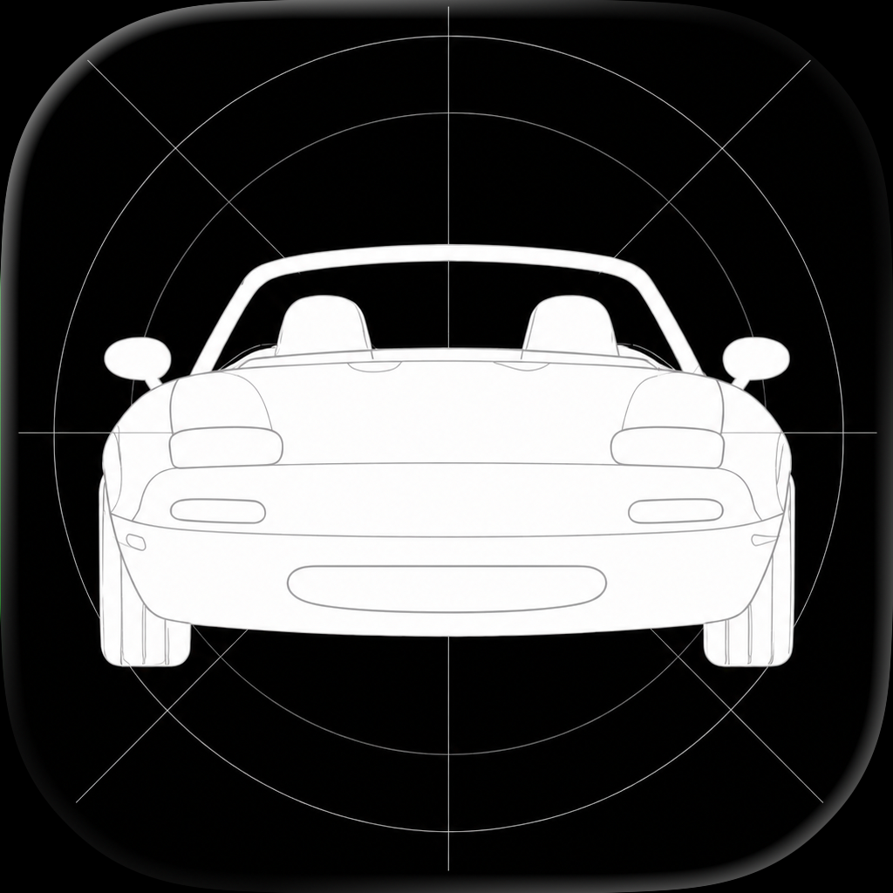
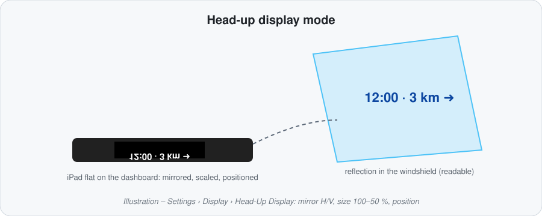

# Showcase-hud

[English](README.md) · **Deutsch**




Inoffizieller Build von [Showcase](https://github.com/amineross/showcase) von Amine Rostane, dem Software-Empfänger für kabelloses CarPlay auf gejailbreakten iPads und iPhones. Er ergänzt:

- **Head-up-Display**-Seite unter Einstellungen › Anzeige: horizontal/vertikal spiegeln, Bildgröße (100–50 %) und Position (links/Mitte/rechts, oben/Mitte/unten). So wird das flach auf dem Armaturenbrett liegende Gerät zum Head-up-Display, das sich in der Frontscheibe spiegelt. Der Rest des Bildschirms bleibt schwarz.
- **CarPlay-Größe** unter Einstellungen › Anzeige (experimentell): meldet dem iPhone eine physische Bildschirmgröße, damit CarPlay seine Oberfläche kleiner oder größer zeichnet. Wirkt ab der nächsten Verbindung.
- **Deutsche** Übersetzung.



### Head-up-Display benutzen

1. Showcase-hud installieren (siehe unten) und das iPhone wie gewohnt verbinden.
2. **Einstellungen › Anzeige › Head-up-Display** öffnen.
3. **Vertikal spiegeln** einschalten (und horizontal, falls deine Scheibe das braucht), eine **Größe** (z. B. 60 %) und eine **Position** (z. B. Mitte/oben) wählen.
4. Das Gerät mit dem Bildschirm nach oben flach unter die Frontscheibe aufs Armaturenbrett legen und die Helligkeit auf Maximum stellen. Alles außerhalb des Bildes bleibt schwarz, sodass sich nur das CarPlay-Bild spiegelt.

Spiegelung und Deutsch sind upstream eingereicht: [amineross/showcase#43](https://github.com/amineross/showcase/pull/43), [amineross/showcase#44](https://github.com/amineross/showcase/pull/44).

## Installation

Diese Quelle in Sileo, Zebra oder Cydia hinzufügen:

```text
https://dr-apple.github.io/showcase-hud
```

Dann **Showcase-hud** installieren. Es ersetzt das offizielle Showcase-Paket. Einstellungen und das gekoppelte Auto bleiben erhalten, weil die App Bundle-ID und Pfade behält. Zurück geht es, indem du Showcase wieder aus der offiziellen Quelle installierst.

Es gibt Pakete für rootful (`iphoneos-arm`) und rootless (`iphoneos-arm64`, z. B. palera1n rootless oder Dopamine).

## Quellcode und Lizenz

Showcase steht unter GPL-3.0. Der Quellcode dieses Builds ist der [`hud`-Branch von dr-apple/showcase](https://github.com/dr-apple/showcase/tree/hud). Die Pakete nutzen die offiziellen Pakete 1.0 Beta 5-3; App und CarPlay-Dienst sind aus diesem Branch neu gebaut, dazu kommen ein deutsches `de.lproj` und der Anzeigename *Showcase-hud*.

Nicht mit dem ursprünglichen Autor verbunden und nicht von ihm unterstützt. Probleme mit diesem Build bitte hier melden, nicht upstream.
