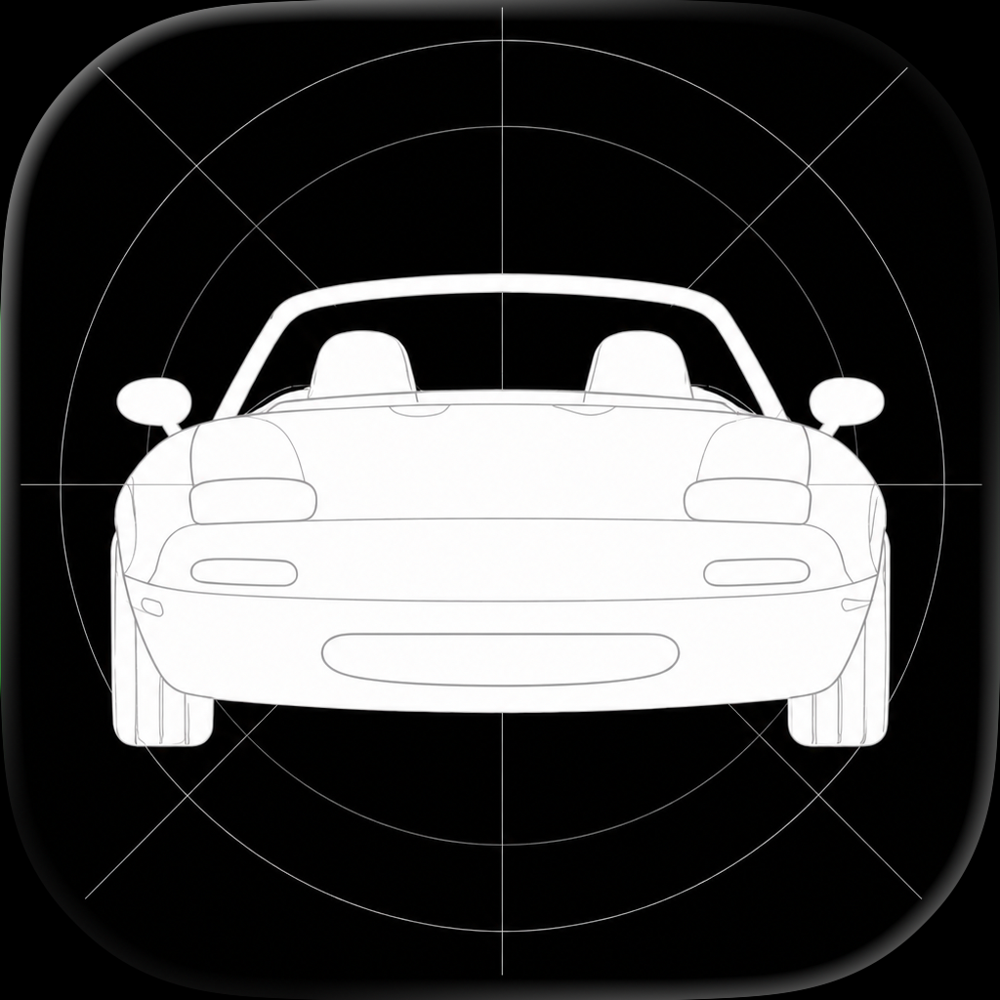
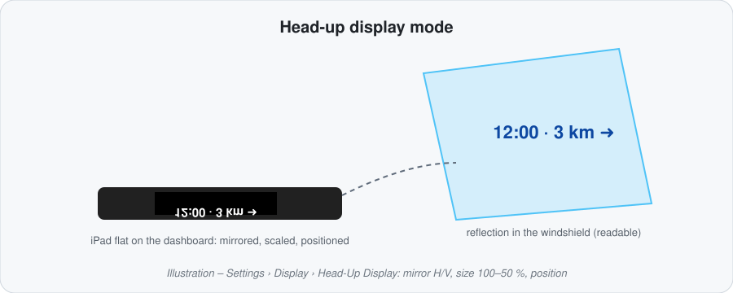

# Showcase-hud

**English** · [Deutsch](README.de.md)




Unofficial build of [Showcase](https://github.com/amineross/showcase) by Amine Rostane, the software wireless CarPlay receiver for jailbroken iPads and iPhones. It adds:

- **Head-Up Display** page in Settings › Display: mirror horizontally / vertically, picture size (100–50 %) and position (left/center/right, top/center/bottom), so the device lying flat on the dashboard works as a head-up display reflected in the windshield. The rest of the screen stays black.
- **CarPlay Size** in Settings › Display (experimental): advertises a physical screen size to the iPhone so CarPlay can draw its interface smaller or larger. Takes effect on the next connection.
- **German** translation (Deutsch).



### Using the head-up display

1. Install Showcase-hud (below) and connect your iPhone as usual.
2. Open **Settings › Display › Head-Up Display**.
3. Turn on **mirror vertically** (and horizontally if your windshield needs it), pick a **size** (e.g. 60 %) and a **position** (e.g. center/top).
4. Lay the device flat on the dashboard below the windshield, screen up, and turn the brightness to maximum. Everything outside the picture stays black so only the CarPlay image reflects.

Mirroring and German are submitted upstream: [amineross/showcase#43](https://github.com/amineross/showcase/pull/43), [amineross/showcase#44](https://github.com/amineross/showcase/pull/44).

## Install

Add this source in Sileo, Zebra or Cydia:

```text
https://dr-apple.github.io/showcase-hud
```

Then install **Showcase-hud**. It replaces the official Showcase package. Settings and the paired car are kept, because the app keeps its bundle ID and paths. To go back, install Showcase from the official source again.

Rootful (`iphoneos-arm`) and rootless (`iphoneos-arm64`, e.g. palera1n rootless or Dopamine) packages are available.

## Source and license

Showcase is GPL-3.0. The source of this build is the [`hud` branch of dr-apple/showcase](https://github.com/dr-apple/showcase/tree/hud). The packages reuse the official 1.0 Beta 5-3 packages with the app and CarPlay service binaries rebuilt from that branch, a German `de.lproj` and the display name *Showcase-hud*.

Not affiliated with or supported by the original author. Please report problems with this build here, not upstream.
